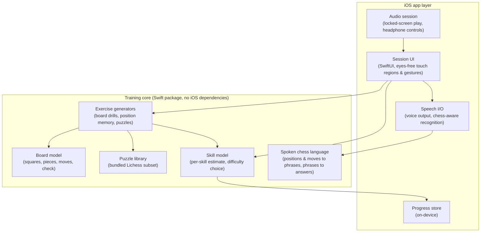

# High-Level Design: hear-chess

## Problem

Blindfold chess — holding the board in your head and calculating without seeing it — is one of the most effective ways to improve at chess. It is also hard to practise. Most chess software is visual, so the board is always in front of the player and peeking is effortless. The few blindfold trainers that exist assume the player can already read and recall notation fluently, so there is no gentle way in for someone who has never trained without a board.

Training also tends to happen only at a desk. Idle time that suits short mental exercises — a walk, a commute, waiting in a queue — goes unused, because nothing lets a player train with the phone in a pocket and headphones on.

## Approach

hear-chess is an iPhone app that trains board visualization entirely by ear. The app speaks exercises; the player answers by voice or by eyes-free touch. Three kinds of training build on each other:

- **Board drills** — no position at all, just the empty board: square colours, which squares a piece reaches, shortest knight routes, diagonals.
- **Position memory** — the app reads out a small position, then asks questions about it (what attacks the queen, is the king in check, what is on e5). Positions grow as the player improves.
- **Blindfold puzzles** — the app reads out a position with a tactic to find, and the player gives the solution move by move.

### Adaptive difficulty

The app keeps a skill estimate for each kind of exercise and chooses the next exercise to sit just above what the player reliably gets right, judged on both accuracy and response time. A beginner never has to pick a level: they start at the easiest drills and the app moves them on as they succeed. A strong player climbs quickly to larger positions and harder puzzles.

### Eyes-free interaction

Every exercise can be completed without looking at the screen. Speech carries everything the player needs to hear. Input works two ways, and the player can use either at any moment:

- **Voice** — chess-aware speech recognition that understands squares, pieces and moves, and confirms or asks again when it is unsure (for example between "b" and "d").
- **Touch without sight** — whole-screen gestures and large regions whose meaning is announced by voice, never small buttons that need to be seen.

Training continues with the screen locked, and headphone controls can pause, repeat or skip.

### Everything on the phone

All content and all progress stay on the device. There is no account and no server, so the app works offline and nothing about the player leaves the phone. Puzzles come from a filtered subset of the Lichess puzzle database (public domain, CC0), chosen for positions that are speakable and solvable blindfold, and bundled with the app.

## Target Users

- **Improving players** who know chess and notation and want to calculate and visualize better. They want to start at a useful level quickly and train in short sessions away from a desk.
- **Beginners at blindfold chess**, including players still unsure of notation. They need a gentle start — square colours and piece movement on an empty board — and a sense of progress before positions get large.

The first version is built for personal use and a small circle of friends using TestFlight, not for public release.

## Goals

- A player can complete a full training session with the phone in a pocket and headphones on, without looking at the screen.
- A beginner can open the app for the first time and start training without choosing a level or reading instructions.
- Difficulty follows the player: a player who answers almost everything correctly is moved to harder exercises, and one who is struggling is moved to easier ones, within a single session.
- Voice input handles misrecognitions gracefully: an uncertain answer is confirmed or asked again, never silently scored as wrong.
- The app works with no network connection.

## Non-Goals

- **Full games against an opponent.** The first version has drills, position memory and puzzles only; playing complete blindfold games against an engine or another person is out of scope.
- **Visual chess.** The app is not a chess board app with audio added; it does not offer a visual board for normal play.
- **Accounts, sync or online features.** No sign-in, cloud backup, leaderboards or multiplayer.
- **Android.** The first version is iPhone only.
- **Public release.** No App Store listing, monetization, analytics or onboarding beyond what a first-time friend needs.

## Tenets

- **Eyes-free first.** When a feature could rely on the screen or could work by ear alone, design it to work by ear alone; anything visual is an optional extra.
- **Working training over polish.** When effort could go into making training work well or into presentation and finish, put it into training.

## System Design

The app is a native Swift/SwiftUI iPhone app split into a platform-independent training core and an iOS layer that handles speech, touch and audio.

- **Board model** — the rules of chess needed for exercises: squares and colours, piece movement, attacks, check and legal moves.
- **Exercise generators** — produce exercises of each kind at a requested difficulty, and check answers.
- **Skill model** — keeps a skill estimate per kind of exercise from accuracy and response time, and chooses the next exercise and its difficulty.
- **Spoken chess language** — turns positions, questions and moves into natural spoken phrases, and turns recognized speech into structured answers, flagging uncertain matches.
- **Puzzle library** — the bundled puzzle subset with ratings and themes, queried by difficulty. A build-time script filters the Lichess database into the bundle.
- **Speech I/O** — iOS speech synthesis and on-device speech recognition, driven by the spoken chess language.
- **Session UI** — runs a training session: announces exercises, accepts voice or eyes-free touch input, gives feedback.
- **Audio session** — keeps a session running with the screen locked and maps headphone controls to pause, repeat and skip.
- **Progress store** — persists skill estimates and history on the device.

The training core has no iOS dependencies, so all exercise logic, scoring and difficulty selection can be tested with `swift test` without a simulator or device.

## Key Design Decisions

| Decision | Alternatives considered | Rationale |
|---|---|---|
| Native Swift/SwiftUI app | React Native with Expo; TypeScript core inside a native shell | Eyes-free use depends on the parts of iOS that cross-platform frameworks reach least reliably: speech recognition, locked-screen audio, headphone controls and VoiceOver. iPhone is the only target, so cross-platform reach buys nothing yet. Costs: building requires a Mac with Xcode, and an Android version would be a separate app. |
| Training core as a separate Swift package with no iOS dependencies | All logic inside the app target | Keeps the logic that most needs to be correct testable quickly and without a device, and keeps speech and UI concerns out of chess and scoring logic. |
| All data on the device, no accounts | Account with cloud sync; on-device with sync designed in | Offline use and privacy matter more than multi-device progress for a personal app. Cost: progress is lost with the phone unless the device backup includes it. |
| Puzzles from a bundled, filtered Lichess subset | Generating puzzles with an on-device engine; a hand-curated set | Lichess puzzles are human-played, rated, themed and public domain; filtering for small positions and short solutions gives a large supply of puzzles that are speakable blindfold. Generated puzzles tend to feel unnatural, and a curated set runs out. |
| Adaptive difficulty per kind of exercise | A fixed path of levels; the player chooses | Lets beginners start without choosing a level and lets strong players skip ahead, without designing a course by hand. |

## Success Metrics

- You routinely train on walks or commutes with the phone in a pocket. **Broken if** a session regularly needs a glance at the screen to continue.
- A friend new to blindfold training starts a first session within a minute of opening the app, without help. **Broken if** they have to ask what to do or pick a level.
- Over weeks of use, the skill estimates rise and the exercises the app chooses get harder. **Broken if** difficulty stalls while accuracy stays high, or keeps rising while accuracy falls.
- Voice answers are accepted correctly the large majority of the time. **Broken if** misrecognized answers are scored as wrong often enough that the player switches to touch to avoid it.

## Open Questions

- Whether on-device speech recognition keeps working reliably with the screen locked for a whole session, or whether some exercises need the app in the foreground.
- How positions are best read aloud: piece by piece, square by square, or grouped by side — and how that changes as positions grow.
- Which puzzle filters (piece count, solution length, themes) give puzzles that are solvable blindfold at each level.

## References

- Lichess puzzle database (CC0): https://database.lichess.org/#puzzles
- Apple Speech framework (`SFSpeechRecognizer`) and `AVSpeechSynthesizer`
- Apple `MPRemoteCommandCenter` for headphone controls
