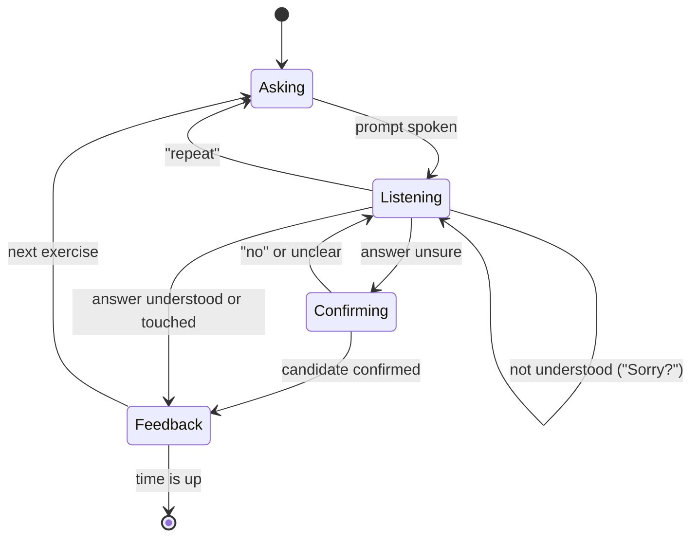

# Session

## Context and Design Philosophy

A session is one short training sitting: the app asks, the player answers, and the app moves on. The session ties the other parts together — it asks the ladder for an exercise, has spoken chess word it, speaks it through voice, listens through voice and touch at once, checks the answer and gives feedback. It lives in the iOS layer, but its flow is a state machine that can be driven and tested without real audio.

A session should feel like a calm coach: it says only what is needed, waits as long as the player needs, and is easy to start and stop without looking.

## Starting and ending

- A session starts when the player taps anywhere on the screen or presses play on their headphones.
- At the very first session, before the first question, the app explains in one or two sentences how to answer by voice and by touch.
- Once about 7 minutes have passed, the session finishes the current exercise and then ends.
- The player can end it at any time by saying "stop" or with the stop gesture.
- When a session ends, the app says a one-line summary: how many answers were right out of how many, and any drill that moved level ("12 of 14 right. Diagonals moved up to level 2.").

## One exercise

- **Asking** — the prompt is spoken. Listening starts when the prompt ends.
- **Listening** — voice and touch are both live; whichever answers first is used. The session waits in silence with no time limit. After 15 seconds with no answer it says "Repeat?" once, and then waits again.
- **Not understood** — the app says "Sorry?" and keeps listening.
- **Unsure** — the app asks about the first candidate: "b four?" A "yes" accepts it. A "no" asks about the next candidate; when there is none left, the app asks the player to say it again.
- **Feedback** — a short sound for right and a different one for wrong. After a wrong answer the correction is spoken. Then the next exercise is asked straight away.
- **Repeat** says the prompt again; the answer time keeps counting from the first time it was asked.

The answer time is measured from the end of the prompt to the moment the answer arrives. For a confirmed unsure answer, it is the time when the player first spoke it.

## Pause and interruptions

"Pause", the pause gesture or the headphones' play/pause button pauses the session after the current prompt. Play resumes it by repeating the current question. A phone call or other audio interruption pauses the session the same way.

## Decisions & Alternatives

| Decision | Chosen | Alternatives Considered | Rationale |
|---|---|---|---|
| Session length | About 7 minutes, ending at an exercise boundary | A fixed number of exercises; open-ended | Short daily sessions are what training guides recommend, and minutes are what fits into idle moments. Cutting off mid-exercise would lose a result. |
| Answer time limit | None; offer to repeat after 15 seconds | A time limit per question | Pressure hurts beginners. Speed still matters through the ladder's target times. |
| Feedback | Sound for right; sound plus correction for wrong | Explanations; "try again" | Keeps pace high and teaches the right answer in the moment, without lecturing. |
| Listening starts after the prompt | Yes | Listening during the prompt | The app's own speech would be heard as an answer when playing through the speaker, and a player should hear the whole question. |

## Open Questions & Future Decisions

### Deferred
1. Whether the 7-minute length should become a setting.
2. Sessions that mix rungs, once more than one is open.
