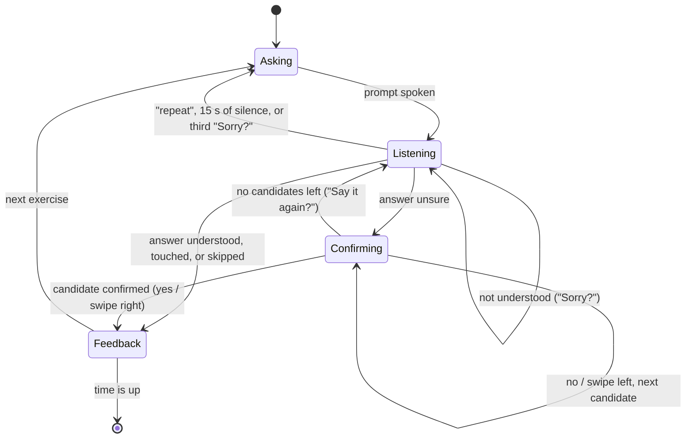

# Session

## Context and Design Philosophy

A session is one short training sitting: the app asks, the player answers, and the app moves on. The session ties the other parts together — it asks the ladder for an exercise, has spoken chess word it, speaks it through voice, listens through voice and touch at once, checks the answer and gives feedback.

## Session engine

The session's flow is a state machine in the training core, the **session engine**. It has no iOS dependencies. It takes events in — taps and gestures, recognized speech and recognition errors, "speech finished", media commands, audio interruptions and headphone changes, and the passing of time — and returns effects: speak this text, stop speaking, listen for these answers and commands, stop listening, play a sound, keep the screen awake or not, set the audio mode, take or give up the lock screen's playing-app role, save progress, and report the session's end. The iOS layer turns real input into events and carries out the effects. Because the engine also decides what gestures, media commands and interruptions mean at each moment, those behaviours from the touch, audio and voice designs are tested through it too.

A session should feel like a calm coach: it says only what is needed, waits as long as the player needs, and is easy to start and stop without looking.

## Starting

- With the app on screen and no session running, a single tap anywhere starts a session.
- With no session running, the headphones' play button makes the app ask "Start training?". A second press within 10 seconds, saying "yes" within that time, or a tap on the screen starts the session; anything else, or nothing, cancels.
- Taps do not start a session until the first-launch permission step is finished.
- When a session starts, the app picks a fresh random seed for its exercises and records it with the session.

## What is said at the start

At the start of a session, before the first question, the app says only what applies, in this order: that progress is not being saved (when the store found a progress file from a newer version), then the introduction if it is due, or otherwise — when voice input is off — that answers are by touch.

## The introduction

Until it has been given once, the app starts a session by explaining in one or two sentences how to answer: by voice and by touch when voice is available, by touch only when it is not. The introduction counts as given once it has been spoken to the end; a session stopped during it gives it again next time. While it is spoken, only pause and stop work, and resuming after a pause starts it again from the beginning.

## Ending

- The session's clock counts only time when the session is not paused, from the first question onwards. Once it reaches 7 minutes, the session finishes the current exercise and then ends.
- The player can end it at any time by saying "stop" or with the stop gesture, or by staying paused for 10 minutes in a row. An exercise that has not been answered when the session ends is dropped.
- When a session ends, the app says a one-line summary: how many answers were right out of how many, and any drill that moved level ("12 of 14 right. Diagonals moved up to level 2."). "I don't know" and skips count as wrong answers. A session with no answers ends with "Session ended."

## One exercise

- **Asking** — the prompt is spoken. The microphone is off while the app speaks, so input during the prompt is ignored except the pause and stop gestures and the headphones' play/pause button, which act at once.
- **Listening** — voice and touch are both live, and whichever completes an answer first is used. The session waits in silence with no time limit. After 15 seconds with no speech and no touch since the app last spoke, it simply asks the question again, once per exercise, and then waits again.
- **Not understood** — the app says "Sorry?" and keeps listening. On the third in a row it repeats the question instead and starts counting again.
- **Confirming** — the app asks about a candidate: "b four?". This happens when it heard two or more different answers, or only a weak one. "Yes" or a swipe right accepts it. "No" or a swipe left asks about the next candidate; when none is left, the app says "Say it again?" and goes back to listening. While confirming, only yes or no to the candidate counts as an answer; repeat, "I don't know", pause and stop still work.
- **Skip or "I don't know"** — counts as a wrong answer and goes to feedback, correction included.
- **Feedback** — a short sound for right and a different one for wrong. After a wrong answer the correction is spoken. Then the next exercise is asked straight away.
- **Repeat** says the prompt again; the answer time keeps counting from the first time it was asked.

The answer time runs from the end of the prompt to the moment the player begins to give the answer — the recognizer's time for the first word of the attempt that produced the answer, or the first touch of it — and excludes paused time. For a confirmed unsure answer, it is the start of the attempt in which the player first spoke it.

## Pause

Pause comes from saying "pause", the pause gesture, the headphones' play/pause button, an audio interruption such as a phone call, or headphones disconnecting. It takes effect at once from any state: any speech in progress stops, any confirmation or touch pick in progress is dropped, and the microphone listens only for "resume" and "stop". A paused session still counts as running, so the headphones' play button resumes it. Resuming — by saying "resume" or "continue", the pause gesture or the play button — asks the current question again, with its automatic repeat and "Sorry?" count reset. A session paused for 10 minutes in a row ends.

## Decisions & Alternatives

| Decision | Chosen | Alternatives Considered | Rationale |
|---|---|---|---|
| Session length | About 7 minutes of unpaused time, ending at an exercise boundary | A fixed number of exercises; open-ended | Short daily sessions are what training guides recommend, and minutes are what fits into idle moments. Cutting off mid-exercise would lose a result. |
| Answer time limit | None; repeat the question once after 15 seconds of silence | A time limit per question; asking "Repeat?" | Pressure hurts beginners, and speed still matters through the ladder's target times. Asking "Repeat?" would make a "yes" ambiguous during yes-or-no questions. |
| Swipes while confirming | Right = yes, left = no to the candidate | Swipes keep their exercise meaning | The player is answering the question they just heard ("dark?"); a swipe that meant light instead would contradict it. |
| Microphone while paused | On, for "resume" and "stop" only | Off while paused | Lets the player resume hands-free and eyes-free. iOS shows the microphone indicator while it is on. |
| Feedback | Sound for right; sound plus correction for wrong | Explanations; "try again" | Keeps pace high and teaches the right answer in the moment, without lecturing. |
| Where the session flow lives | A state machine in the training core, taking events and returning effects | Inside the iOS app layer | The flow is the most intricate part of the app, and in the core every rule can be tested with a fake clock and fake speech, without a device. |
| Listening starts after the prompt | Yes | Listening during the prompt | The app's own speech would be heard as an answer when playing through the speaker, and a player should hear the whole question. |
| Starting from the headphones | Ask "Start training?" and need a second press or "yes" | Start at once; never from headphones | Earbud taps meant for music would otherwise start sessions by accident, while a confirmed start still allows training without taking the phone out. |
| Pause acts immediately | Yes | Pause after the current prompt | A disconnected headset must not keep speaking through the speaker, and a player who pauses wants silence now. |
| Long pause | Ends the session after 10 minutes | Stay paused indefinitely | A forgotten paused session would otherwise hold the phone's audio and skew the next session's summary. |

## Open Questions & Future Decisions

### Deferred
1. Whether the 7-minute length should become a setting.
2. Sessions that mix rungs, once more than one is open.
