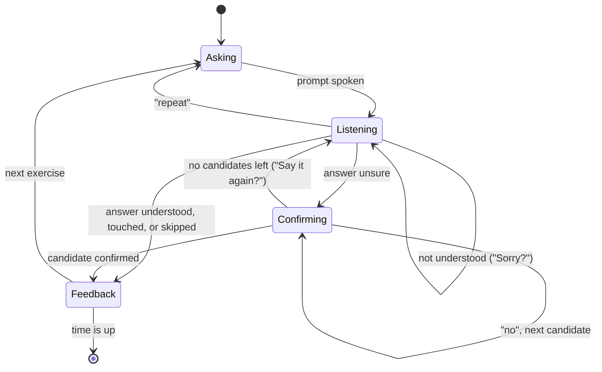

# Session

## Context and Design Philosophy

A session is one short training sitting: the app asks, the player answers, and the app moves on. The session ties the other parts together — it asks the ladder for an exercise, has spoken chess word it, speaks it through voice, listens through voice and touch at once, checks the answer and gives feedback. It lives in the iOS layer, but its flow is a state machine that can be driven and tested without real audio.

A session should feel like a calm coach: it says only what is needed, waits as long as the player needs, and is easy to start and stop without looking.

## Starting

- With the app on screen and no session running, a single tap anywhere starts a session.
- With no session running, the headphones' play button makes the app ask "Start training?". A second press within 10 seconds, or saying "yes", starts the session; anything else, or nothing, cancels.
- When a session starts, the app picks a fresh random seed for its exercises and records it with the session.

## The introduction

Before the first question of the player's first session, the app explains in one or two sentences how to answer: by voice and by touch when voice is available, by touch only when it is not. The introduction counts as given once it has been spoken to the end; a session stopped during it gives it again next time.

## Ending

- The session's clock counts only time when the session is not paused. Once it reaches 7 minutes, the session finishes the current exercise and then ends.
- The player can end it at any time by saying "stop", with the stop gesture, or by staying paused for 10 minutes. An exercise that has not been answered when the session ends is dropped.
- When a session ends, the app says a one-line summary: how many answers were right out of how many, and any drill that moved level ("12 of 14 right. Diagonals moved up to level 2."). A session with no answers ends with "Session ended."

## One exercise

- **Asking** — the prompt is spoken. Input during the prompt is ignored, except pause and stop, which act at once.
- **Listening** — voice and touch are both live, and whichever completes an answer first is used. The session waits in silence with no time limit. After 15 seconds of silence since the app last spoke, it says "Repeat?" once for that exercise, and then waits again.
- **Not understood** — the app says "Sorry?" and keeps listening. After three in a row it repeats the question instead.
- **Confirming** — the app asks about the first candidate: "b four?". "Yes" accepts it. "No" asks about the next candidate; when none is left, the app says "Say it again?" and goes back to listening. A touch answer while confirming is taken as the answer.
- **Skip or "I don't know"** — counts as a wrong answer and goes to feedback.
- **Feedback** — a short sound for right and a different one for wrong. After a wrong answer the correction is spoken. Then the next exercise is asked straight away.
- **Repeat** says the prompt again; the answer time keeps counting from the first time it was asked.

The answer time runs from the end of the prompt to the moment the player begins to give the answer — the start of the spoken answer, or the first touch of it — and excludes paused time. For a confirmed unsure answer, it is the time when the player first spoke it.

## Pause

Pause comes from saying "pause", the pause gesture, the headphones' play/pause button, an audio interruption such as a phone call, or headphones disconnecting. It takes effect at once from any state: any speech in progress stops, and listening stops. Resuming — by the same gesture, the play button, or saying "resume" if voice is available — repeats the current question. A session paused for 10 minutes ends.

## Decisions & Alternatives

| Decision | Chosen | Alternatives Considered | Rationale |
|---|---|---|---|
| Session length | About 7 minutes of unpaused time, ending at an exercise boundary | A fixed number of exercises; open-ended | Short daily sessions are what training guides recommend, and minutes are what fits into idle moments. Cutting off mid-exercise would lose a result. |
| Answer time limit | None; offer to repeat after 15 seconds | A time limit per question | Pressure hurts beginners. Speed still matters through the ladder's target times. |
| Feedback | Sound for right; sound plus correction for wrong | Explanations; "try again" | Keeps pace high and teaches the right answer in the moment, without lecturing. |
| Listening starts after the prompt | Yes | Listening during the prompt | The app's own speech would be heard as an answer when playing through the speaker, and a player should hear the whole question. |
| Starting from the headphones | Ask "Start training?" and need a second press or "yes" | Start at once; never from headphones | Earbud taps meant for music would otherwise start sessions by accident, while a confirmed start still allows training without taking the phone out. |
| Pause acts immediately | Yes | Pause after the current prompt | A disconnected headset must not keep speaking through the speaker, and a player who pauses wants silence now. |
| Long pause | Ends the session after 10 minutes | Stay paused indefinitely | A forgotten paused session would otherwise hold the phone's audio and skew the next session's summary. |

## Open Questions & Future Decisions

### Deferred
1. Whether the 7-minute length should become a setting.
2. Sessions that mix rungs, once more than one is open.
